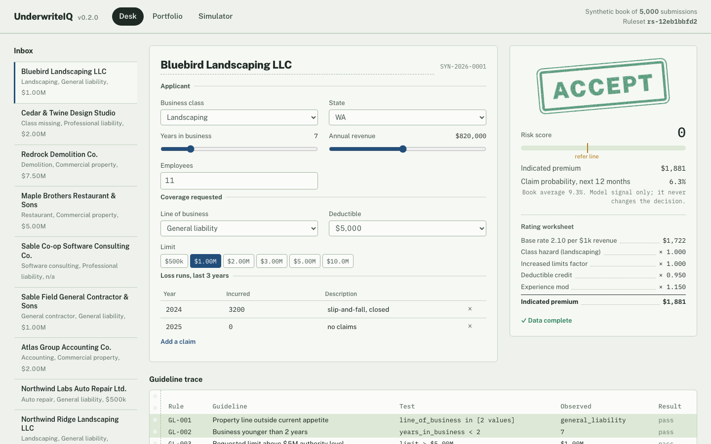
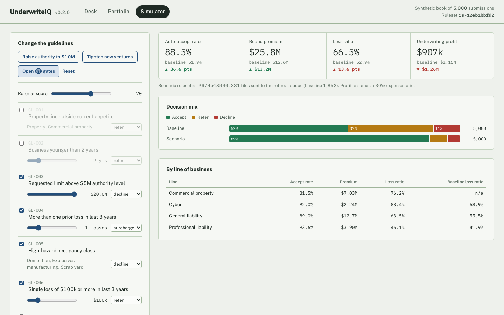
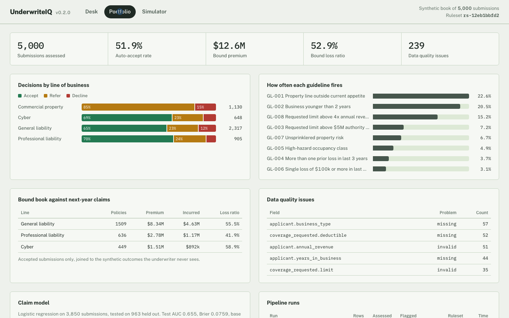
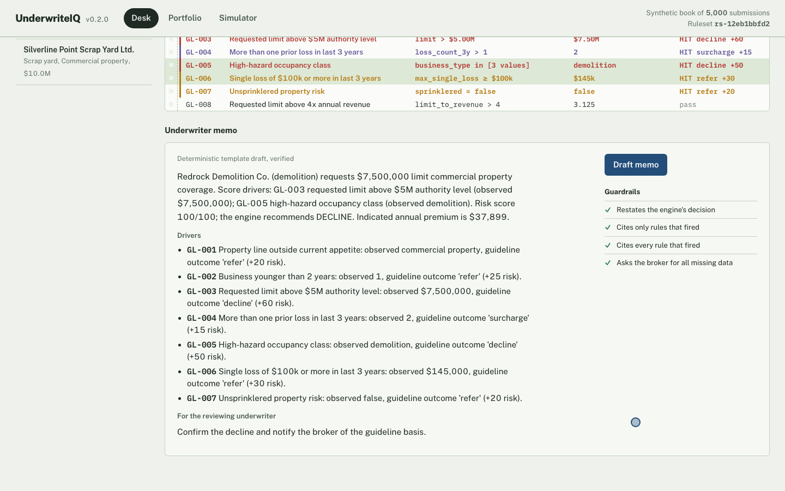
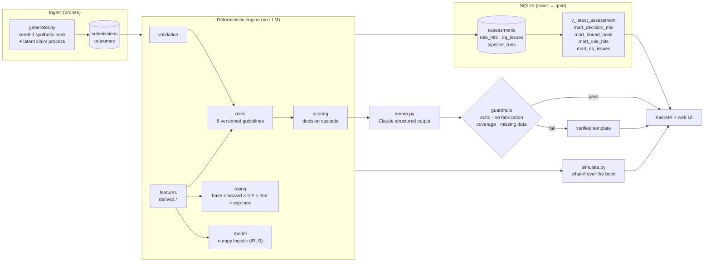

# UnderwriteIQ

[](https://github.com/aayanrehman/underwriteiq/actions/workflows/ci.yml)


**A commercial insurance underwriting simulator.** It takes a submission through validation, versioned guideline rules, a rating worksheet and a claim-probability model. A human underwriter gets the decision, its full audit trail, and a memo drafted by an LLM and checked by code.
Then it re-underwrites a 5,000-risk synthetic book under any rule change you can
dream up and tells you what that change would have done to the loss ratio.


<sub>39-second walkthrough, recorded by [`scripts/record_demo.py`](scripts/record_demo.py) with Playwright against a fresh database ([MP4](docs/demo.mp4)).</sub>

---

## What it does

| | |
|---|---|
| **Desk** | Edit a submission with live controls (class, tenure, revenue, limit, losses, sprinklers). Every change re-runs the engine (under 1 ms per submission). The decision stamp, risk score, rating worksheet, model signal and green-bar guideline trace all update. |
| **Memo** | One click drafts an underwriter memo. With `ANTHROPIC_API_KEY` set, Claude writes it as structured output. Four deterministic guardrails then verify it against the engine before it's shown. |
| **Portfolio** | Decision mix by line, guideline hit rates, data-quality issues, bound-book loss ratio and pipeline run history. All of it is read from SQL views over the assessment tables. |
| **Simulator** | Toggle rules, move thresholds, change outcomes. All 5,000 submissions are re-underwritten in ~20 ms and scored against their hidden next-year claims. |

<table>
<tr>
<td></td>
<td></td>
</tr>
<tr>
<td></td>
<td></td>
</tr>
</table>

## Architecture



The design has one rule: **the LLM never decides.** Validation, rule matching, scoring, rating and the decision cascade are pure, tested Python. Claude only explains a decision that has already been made, and code checks that explanation before any human reads it. When Claude is unavailable, or its draft fails a check, the desk falls back to a deterministic template and records why.

## Engineering highlights

**Data engineering**
- **A seeded synthetic book with ground truth.** Each risk has a latent annual claim frequency driven by class hazard, tenure, exposure, sprinkler status and an unobserved quality term. The same process generates the 3-year loss runs the underwriter sees *and* the next-year outcome they don't, which gives "did this rule change help?" a correct answer. About 5% of rows carry injected defects: missing fields, string-typed numbers, negative revenue.
- **Batch ingestion is idempotent and audited.** One transaction per batch: malformed records are counted and skipped, never fatal. Each run is logged to `pipeline_runs` with row counts, DQ-flag counts, duration and ruleset version. The full 5,000-row book loads in about 0.7 s.
- **Audit lineage on every decision.** Each assessment carries a content-hashed `ruleset_version` (order-independent, so the same rules always give the same hash), the engine version and an input hash. Re-assessing keeps history; the marts read only the latest assessment per submission.
- **Normalized engine output.** `rule_hits` and `dq_issues` are real tables with indexes, not JSON blobs. That's what makes "how often does GL-002 fire?" a one-line `GROUP BY`. The schema is plain SQL that ports 1:1 to Postgres.
- **One feature layer.** Rules, rating and the model all read the same `derived.*` features (loss count, max single loss, limit-to-revenue), so "loss count" means one thing everywhere.

**AI / ML engineering**
- **Grounded generation with verification.** `messages.parse` returns a Pydantic `MemoDraft`. `verify()` asserts that it restates the engine's decision, cites only rules that fired, cites every rule that fired, and requests every missing field. The skill file in `.agents/` *is* the system prompt, so the prompt and its docs can't drift apart.
- **Graceful degradation.** Network errors, auth failures, refusals and failed guardrails all fall back to a verified template, and the reason appears in the UI. The desk never blocks on the model.
- **Evals in CI.** `evals/memo_eval.py` scores memo faithfulness across a sampled book. The template backend must score 100% on every check in CI. Run `--llm` to score raw Claude drafts before fallback.
- **An interpretable loss model.** L2-regularized logistic regression fitted by Newton–Raphson in about 40 lines of numpy. It reports held-out AUC, Brier score and standardized coefficients, and it is shown as an advisory signal that the decision path never reads.

**Software**
- 46 tests (93% coverage): rating maths, feature windows, generator determinism, AUC correctness, **simulator ≡ engine equivalence on every submission**, guardrails catching a deliberately hallucinating fake LLM, batch ingest and history semantics, every API route, and the CLI.
- CI runs on Python 3.11, 3.12 and 3.13: ruff, pytest with coverage, the memo eval, and a CLI pipeline smoke run.
- No frontend build step: about 700 lines of vanilla JS and CSS served by FastAPI. The decision colors are validated for colorblind separation and 3:1 contrast.

## Results on the synthetic book

Seed 42, 5,000 submissions. Run `uwiq simulate` to reproduce.

| Scenario | Auto-accept | Bound premium | Loss ratio | UW profit* |
|---|---:|---:|---:|---:|
| Baseline guidelines | 51.9% | $12.6M | 52.9% | $2.16M |
| Raise authority to $10M | 55.3% | $15.0M | 49.6% | $3.07M |
| Decline new ventures under 4 yrs | 41.8% | $10.0M | 42.6% | $2.73M |
| "Open the gates" (drop appetite, tenure and sprinkler rules, refer at 70) | 88.5% | $25.9M | 66.5% | $0.91M |

<sub>*Premium × (1 − 30% expense ratio) − incurred. Accepts only; referrals go to a human queue.</sub>

The point the simulator makes is the real underwriting trade-off: loosening appetite doubles premium and cuts profit by more than half.

**Claim model (held-out 20%):** AUC 0.655, Brier 0.0759 against a 9.35% base claim rate. That's in line with what frequency models achieve on real small-commercial books, where most variance is irreducible. Tenure, class hazard and revenue carry most of the signal.

## Quickstart

```bash
git clone https://github.com/aayanrehman/underwriteiq && cd underwriteiq
make install          # venv + editable install with dev extras
make serve            # http://localhost:8000
```

Or with Docker: `make docker`. Optional: `export ANTHROPIC_API_KEY=...` to have Claude draft memos.

```bash
uwiq ingest --n 5000                       # generate + batch-load the book, log the run
uwiq report                                # print the marts straight from SQL
uwiq simulate --set GL-003.value=10000000 GL-002.enabled=false
uwiq train                                 # fit the loss model, write data/model.json
python -m underwriteiq.pipeline data/samples/submission_redrock_decline.json
make test eval lint
```

### API

| Route | |
|---|---|
| `POST /api/assess` | Full assessment: decision, score, premium, model signal, per-rule trace, rating steps, DQ report |
| `POST /api/memo` | Drafted memo + guardrail results + source (`claude` / `template` / `template (fallback)`) |
| `POST /api/simulate` | `{overrides: {"GL-003": {"value": 1e7}}, refer_threshold}` → baseline vs scenario, by line |
| `GET /api/portfolio` | KPIs, marts and pipeline runs |
| `GET /api/meta` | Rules, classes, ruleset version, model card |
| `POST /assess` | v0.1 contract, kept for compatibility; persists the assessment |

Interactive docs are at `/docs`.

## Repository layout

```
src/underwriteiq/
  models.py       Submission / GuidelineRule / Assessment dataclasses
  features.py     derived features shared by rules, rating and model
  validation.py   required fields, types, ranges, loss-run integrity
  rules.py        8-operator rule matcher over dotted field paths
  guidelines.py   default ruleset + content-hash versioning
  scoring.py      risk score and decision cascade
  rating.py       rating worksheet (class hazard, ILF, deductible credit, experience mod)
  generator.py    seeded synthetic book with latent claim process and DQ defects
  model.py        numpy logistic regression, AUC, model card
  simulate.py     portfolio what-if over the book
  memo.py         Claude drafting, guardrails, template fallback
  store.py        SQLite schema, normalised hit/DQ tables, marts as views
  pipeline.py     single + batch assessment, run logging
  api.py, cli.py  FastAPI app and `uwiq` command
  web/            desk UI (HTML/CSS/JS, no build)
.agents/skills/underwriting/SKILL.md   LLM role + hard rules (also the runtime system prompt)
evals/            memo faithfulness eval
scripts/          demo recorder
tests/            46 tests
```

## Why I built it

I hold the AINS (Associate in Insurance) designation and interned at Voya Financial, where I got interested in data governance: how financial-services decisions get documented and audited. UnderwriteIQ is my answer to a question that came out of that work. How do you use LLMs in a regulated decision without letting them make the decision? My answer: keep the decision in tested, versioned, reproducible code, and treat the model as a writer whose work gets checked.

**Honest scope:** everything here is synthetic. The applicants, loss runs, rates, guidelines and outcomes don't belong to any real carrier or policyholder. It has never been used on a real underwriting decision. The rates and the latent loss process are calibrated to be plausible, not filed.

## Roadmap

- Postgres backend behind the same `Store` interface (the schema already maps 1:1)
- ACORD 125/126 ingestion of broker submission PDFs, with Claude doing the extraction behind a schema-validation gate
- Gradient-boosted frequency/severity models with a calibration report next to the logistic baseline
- Referral queue with underwriter overrides captured as labelled data
- Claude-backend eval scores tracked per prompt version

## Attribution

`vendor/aspire/` contains [nemmons/aspire](https://github.com/nemmons/aspire)
(A Simple Python Insurance Rating Engine, MIT © Nate Emmons), vendored
unmodified as a reference for rating-manual concepts. `rating.py` is written from scratch and does not import it. See [THIRD_PARTY_NOTICES.md](THIRD_PARTY_NOTICES.md).

MIT licensed.
